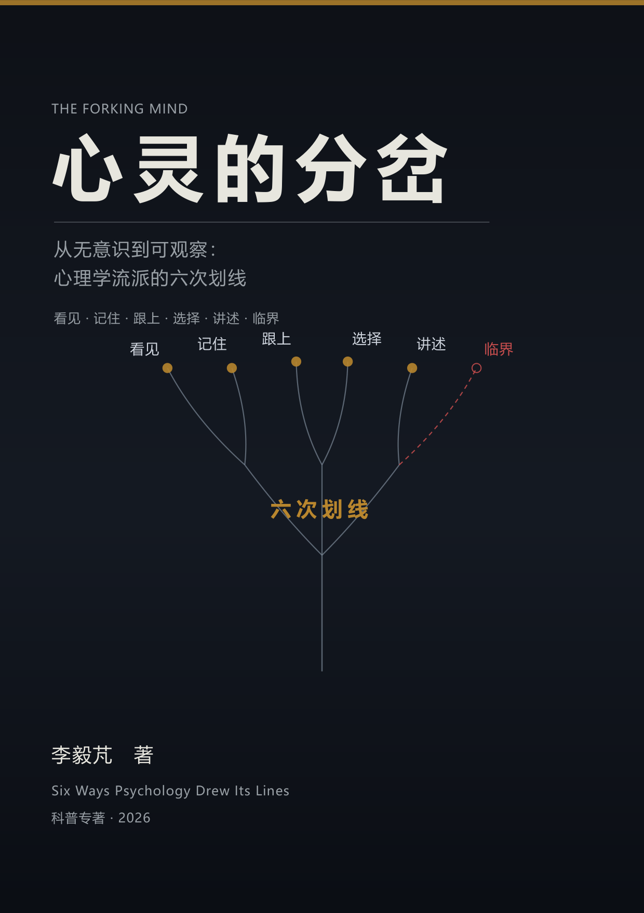

# 心灵的分岔 · The Forking Mind

> 从无意识到可观察——心理学流派的六次划线
>
> 一本科普专著：用“看见、记住、跟上、选择、讲述、临界”六个提问，读心理学一百五十年的流派史。
>
> **DOI**：[10.5281/zenodo.23637236](https://doi.org/10.5281/zenodo.23637236)　·　概念 DOI：10.5281/zenodo.23637235

[](https://creativecommons.org/licenses/by/4.0/)
[](LICENSE-MIT)



---

## 一句话主张

> **心理学流派史不是一部“谁取代谁”的进步史，也不是一部“谁都被冤枉”的平反史，而是一部“谁在哪里划线、又把什么划到外面、最后由谁付账”的账本史。**

每一个流派都是一次尝试：先划一条线，再决定记住什么、用什么钟、保哪两项、请谁定价、在哪里设门槛。六核问的是“它在哪一步让出了什么”，不是“它对不对”。

## 六个提问（不是六个裁判）

| 核心 | 在心理学里问什么 | 它防的误读 |
|---|---|---|
| **看见** | 它把什么划进“心理”，把什么划到外面？ | “没研究＝不存在” |
| **记住** | 它认为人记住什么、忘什么、为什么忘？ | “忘了就是不重要” |
| **跟上** | 它用的是哪一个钟？跟得上对象吗？ | “慢就是深，快就是浅” |
| **选择** | 它在紧预算下保了哪两项、让出了哪一项？ | “让出＝失败” |
| **讲述** | 谁有资格说“这是科学的”？置信度怎么分配？ | “不科学＝无效” |
| **临界** | 这个门槛是观察到的，还是被规定的？ | “有阈值＝有相变” |

## 全书结构

六个部分，二十五章，一条暗线：**划线—深度—约束—回归—意义—定价**。

| 部分 | 主核心 | 章 | 覆盖 |
|---|---|---|---|
| 一　划线的诞生 | 看见 / 记住 | 1—4 | 柏拉图—康德、冯特、布伦塔诺、詹姆斯、构造/机能、格式塔 |
| 二　深度的代价 | 记住 / 选择 | 5—11 | 弗洛伊德、荣格、阿德勒、客体关系、自体/依恋、拉康、神经精神分析、心理测量 |
| 三　可观察的约束 | 看见 / 讲述 | 12—15 | 华生、巴甫洛夫、斯金纳、行为疗法、行为主义的遗产 |
| 四　内部的回归 | 看见 / 记住 | 16—19 | 认知革命、皮亚杰/乔姆斯基、认知神经科学、社会认知 |
| 五　意义与时间 | 选择 / 跟上 | 20—22 | 人本主义、存在主义、发展心理学 |
| 六　系统与定价 | 讲述 / 临界 | 23—25 | 系统/后现代、CBT/正念/积极/文化/进化、六核回望 |

**附录 A—Q（17 个）**：流派×六核对照表、一百五十年时间线、术语表、一百个人名、被埋没与重新发现清单、可证伪登记簿、数据缺口、延伸阅读、分支地图、精神病理学的另一条线、被主流漏掉的传统、中国心理学一百年、二十种疗法对照、心理学与 AI、十二个常见误解与练习册、十个实验/十次复现/方法手册、二十对易混概念。

## 这本书的写法

每一章是同一套五段结构：**一个人物/争议开场 → 一个核心提问展开 → 它让出了什么 → 被埋没与回归 → 一句话带走**。全书配四种深度的装置：正文 / 多想一层 / 再想一层 / 给专家的注 / 动手试试。

- **不裁判疗效**：哪种治疗对哪种问题有效，是临床研究的问题；本书只做“让出”分析。
- **不揭穿**：“讲述”问的是置信度如何被分配，不是“这个流派伪科学”。
- **不假装六核能解释一切**：附录 G 列了它的缺口，附录 F 列了它可以被推翻的地方。
- **证据纪律**：A（可查证/可复算）/ B（稳定但有争议）/ C（思辨/开放）；**结论强度不超过证据强度**。

## 规模

- 309 页（A4 印刷版）；25 章；6 部分；17 个附录。
- 25 幅矢量插图；68 个表；约 26 万字。
- 同时输出：印刷版 PDF、电子阅读版 PDF（B5）、EPUB 3、单文件 HTML、Markdown。

## 怎么构建

```bash
PY="/mnt/d/0_Code/Iris Series/.venv/Scripts/python.exe"
"$PY" analysis/make_figures.py     # 25 幅 SVG
"$PY" analysis/make_cover.py       # 封面
"$PY" analysis/audit.py            # 结构/引用校对 → 校对清单.md
"$PY" build_book.py --pdf          # 印刷版 PDF
"$PY" build_book.py --ereader --pdf
"$PY" build_epub.py
"$PY" build_markdown.py
bash scripts/release.sh            # release/ 交付包
```

## 这个仓库是什么

`source/` 是唯一权威正文来源；`output/`、`release/` 是派生产物。写作约定、工具链与本书的取舍记录在 `AGENTS.md`；方法、数据缺口、读者说明在 `docs/`。

## 引用

见 `CITATION.cff`。归档 DOI 待 Zenodo 发布后写回本文件与 `CITATION.cff`。

## 许可

正文与插图：CC BY 4.0；构建脚本：MIT。欢迎引用、改编、教学使用，请注明作者与来源。
